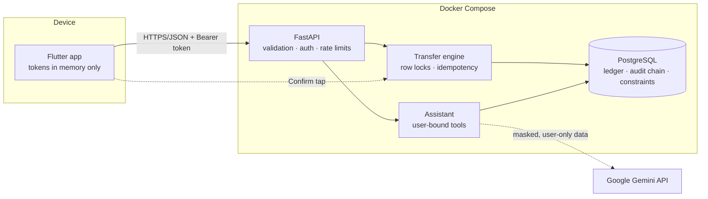

# Sahil — digital banking demo

Sahil (ساحل, "shore") is an **original, fictional** banking app for Bahrain, built as an engineering
portfolio project. It is simple on the surface and careful underneath:

- **Flutter app** (Arabic and English, light and dark) that talks only to its own API.
- **FastAPI + PostgreSQL backend** with a double-entry ledger, migrations and persistent data.
- **Security first**: every control below is implemented in code and covered by automated tests.
- **Personal AI assistant** (Google Gemini, key kept on the server) that sees only the signed-in
  user's data and cannot move money without the user pressing Confirm.

> Fictional data only. No real bank, no real money, no banking integrations. This is a demo and has
> **not** been independently security-audited; it is not production banking software.

## Run it on Windows (no programming needed)

1. Download this repository (green **Code** button → **Download ZIP**, then unzip), or clone it.
2. Double-click **`START-SAHIL.cmd`**.
3. Approve any tool it offers to install (Git, Docker Desktop, Flutter, Chrome). If it installed
   something, start Docker Desktop once and double-click `START-SAHIL.cmd` again.
4. The app opens in Chrome at `http://localhost:5173`. Sign in with the demo account:
   `demo@sahil.example` / `Sahil-Demo-2026`. Other demo people to send money to: `layla`, `yusuf`.

`stop.ps1` stops everything (data is kept). `test.ps1` runs all tests.

The setup script asks once for an optional Gemini API key and saves it in a local `.env` file that
git ignores. Without a key the assistant still works using a built-in engine.

## Run it on macOS / Linux

```sh
printf 'POSTGRES_PASSWORD=%s\nJWT_SECRET=%s\nGEMINI_API_KEY=\n' "$(openssl rand -hex 16)" "$(openssl rand -hex 32)" > .env
docker compose up -d --build --wait        # database + API on http://localhost:8000
bash scripts/smoke.sh                      # end-to-end check
flutter create . --platforms=web --project-name sahil_fintech_demo
flutter run -d chrome --web-port 5173
```

## Architecture



| Layer | Where | Notes |
|---|---|---|
| App | `lib/` | 4 tabs: Home, Activity, Assistant, Card. Security screen behind the shield icon. |
| API | `backend/app/routers/` | `/api/v1/*` and `POST /api/chat`. Interactive docs at `/docs`. |
| Money | `backend/app/transfers.py` | The only code that changes a balance. |
| Assistant | `backend/app/assistant/` | `tools.py` is the complete list of what the model can do. |
| Schema | `backend/migrations/` | Alembic. `0002` adds database-level integrity triggers. |
| Tests | `backend/tests/`, `test/` | 95 backend tests incl. security and concurrency; Flutter widget tests. |

## Security at a glance

Full detail, threat model and known limits: **[docs/SECURITY.md](docs/SECURITY.md)**.
API reference: **[docs/API.md](docs/API.md)**. Test output: **[docs/evidence/](docs/evidence/)**.

| Control | Implementation | Proven by |
|---|---|---|
| Password storage | Argon2id; weak-password rules; equal-time login | `test_auth.py` |
| Sessions | 10-min signed access token checked against a server-side session; single-use rotating refresh tokens stored hashed; reuse detection | `test_auth.py` |
| Brute force | Per-IP and per-account rate limits + database-backed lockout | `test_security.py`, `test_auth.py` |
| Authorization | Every query is scoped to the token's user; other people's ids answer 404 | `test_authorization.py` |
| Transfers | Integer fils, server-side validation and limits, one DB transaction | `test_transfers.py` |
| Concurrency | `SELECT … FOR UPDATE` in fixed order; DB `CHECK` forbids overdraft | `test_concurrency.py` |
| Duplicates | Mandatory `Idempotency-Key`; retries replay the stored result | `test_transfers.py`, `test_concurrency.py` |
| Audit | Hash-chained, append-only log (DB triggers reject edits) | `test_security.py` |
| Secrets | Environment only; app refuses to start with a weak secret; `.env` git-ignored | `test_security.py` |
| Assistant | User-bound tools, no money-moving tool, confirm step, prompt-injection test | `test_assistant.py` |
