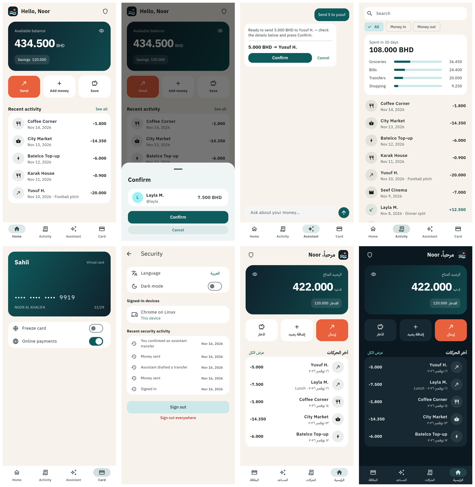
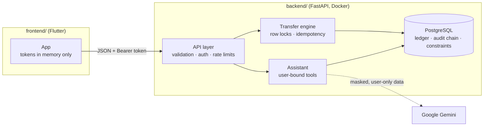

<div align="center">

# Sahil · ساحل

**A full-stack digital banking demo for Bahrain: a Flutter app, a FastAPI + PostgreSQL backend, and a personal AI assistant, built with security first.**

[](https://github.com/isa-aldoy/sahil-fintech-demo/actions/workflows/ci.yml)

-0F5C5E)




</div>

> **Fictional money only.** No real bank, no real accounts, no payment integrations. This is a portfolio
> project. It has **not** been independently audited and is not production banking software.

## What it does

| For the customer | What happens underneath |
|---|---|
| Sign in, see balance and recent activity | Argon2id passwords, short-lived tokens checked against a revocable server-side session |
| Send money in two taps, with a review screen | Row-locked, idempotent transfer into a double-entry ledger; PostgreSQL refuses overdrafts |
| Request money; the other person pays or declines | Only the payer can pay, only once, even with parallel taps; same limits as a transfer |
| Move money to savings, add demo money | Same ledger path, with per-transaction and daily limits |
| Search activity, see spending by category, download a statement | Queries scoped to the signed-in user; CSV export protected against formula injection |
| Freeze the card, turn online payments off | Every change written to a tamper-evident audit log |
| Ask the assistant "how much did I spend?" or "send 5 to layla" | Gemini sees only that user's masked data and can only **draft** a transfer the user must confirm |
| See signed-in devices, sign one out, sign out everywhere | Sessions revoked in the database take effect on the next request |
| Arabic or English, light or dark | Full right-to-left layout, bundled Arabic/Latin font |

## Project layout

```
sahil-fintech-demo/
├── backend/            Python · FastAPI · SQLAlchemy · Alembic   ← the server and all business rules
│   ├── app/
│   │   ├── routers/    auth, banking, requests, chat (HTTP endpoints)
│   │   ├── transfers.py    the only code that changes a balance
│   │   ├── assistant/      Gemini client, built-in fallback, the tools the AI may use
│   │   ├── audit.py        hash-chained audit log
│   │   └── security.py     password hashing and tokens
│   ├── migrations/     database schema, versioned (0002 adds integrity triggers)
│   └── tests/          106 tests: auth, authorization, transfers, concurrency, security, AI, requests
├── frontend/           Dart · Flutter                            ← the app; talks only to the API
│   ├── lib/            screens, API client, Arabic/English strings
│   └── test/           widget tests against a fake backend
├── docs/               security design and threat model, API reference, screenshots, test evidence
├── docker-compose.yml  PostgreSQL + API for local use
└── START-SAHIL.cmd     one double-click setup and launch on Windows
```

**Why two languages?** Flutter is excellent for the app, but the server needs a mature backend ecosystem
for databases, migrations, password hashing and testing. The backend is Python (FastAPI); the Flutter app
holds no business rules and no secrets, and can do nothing the API does not allow.

## Architecture



## Security

The full design, a STRIDE threat model and an honest list of limits are in
**[docs/SECURITY.md](docs/SECURITY.md)**. Every row below is implemented in code and has an automated test.

| Control | How | Test file |
|---|---|---|
| Password storage | Argon2id, weak-password rules, equal-time responses for unknown e-mails | `test_auth.py` |
| Sessions | 10-minute access token tied to a database session; single-use rotating refresh tokens stored hashed; reuse revokes the session | `test_auth.py` |
| Brute force | Per-IP and per-account rate limits, account lockout stored in the database | `test_security.py` |
| Authorization | Every query scoped to the token's user; a test calls every route without a token | `test_authorization.py` |
| Money integrity | Integer fils, no floats; server-side limits; one database transaction per transfer | `test_transfers.py` |
| Race conditions | `SELECT … FOR UPDATE` in a fixed order; 40 parallel requests cannot overspend | `test_concurrency.py` |
| Duplicate payments | Mandatory `Idempotency-Key`; retries replay the original result | `test_transfers.py` |
| Database guarantees | `CHECK` forbids overdraft; ledger and audit log are append-only; each transfer must balance | `test_transfers.py` |
| Audit trail | Hash-chained log; editing any row is detected | `test_security.py` |
| Secrets | From the environment only; the app refuses to start with a weak secret; `.env` is git-ignored | `test_security.py` |
| AI safety | No money-moving tool; drafts expire; prompt injection in a transaction note cannot send money | `test_assistant.py` |

Test output: [docs/evidence/](docs/evidence/) · API reference: [docs/API.md](docs/API.md) (interactive at `/docs` when running).

## Run it

### Windows: no programming needed

1. Download the repository (green **Code** button → **Download ZIP**), then unzip it.
2. Double-click **`START-SAHIL.cmd`**. It checks for Git, Docker Desktop, Flutter and Chrome and offers
   to install anything missing through `winget`, asking you first.
3. Paste a Google Gemini API key when asked, or press Enter to use the built-in assistant.
4. The app opens at `http://localhost:5173`. Demo sign-in: `demo@sahil.example` / `Sahil-Demo-2026`.
   Other demo people: `layla`, `yusuf`.

`stop.ps1` stops the server (your data is kept) and `test.ps1` runs every test.

### macOS / Linux

```sh
printf 'POSTGRES_PASSWORD=%s\nJWT_SECRET=%s\nGEMINI_API_KEY=\n' "$(openssl rand -hex 16)" "$(openssl rand -hex 32)" > .env
docker compose up -d --build --wait        # backend + database on http://localhost:8000
bash scripts/smoke.sh                      # end-to-end check

cd frontend
flutter create . --platforms=web --project-name sahil_fintech_demo
flutter run -d chrome --web-port 5173
```

### Run the tests

```sh
cd backend && pip install -r requirements-dev.txt && pytest      # needs a PostgreSQL test database
cd frontend && flutter test
```

CI runs all of these on every push, plus a Docker Compose end-to-end check and a Windows script check.

## Known limits

No independent penetration test; local demo runs over plain HTTP; no multi-factor authentication;
rate-limit counters live in one process. Details in [docs/SECURITY.md](docs/SECURITY.md#known-limits-honest-list).
